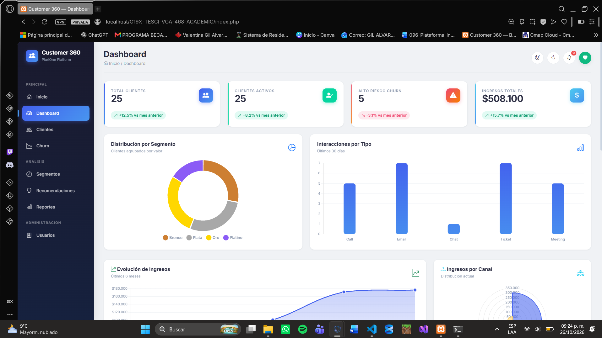
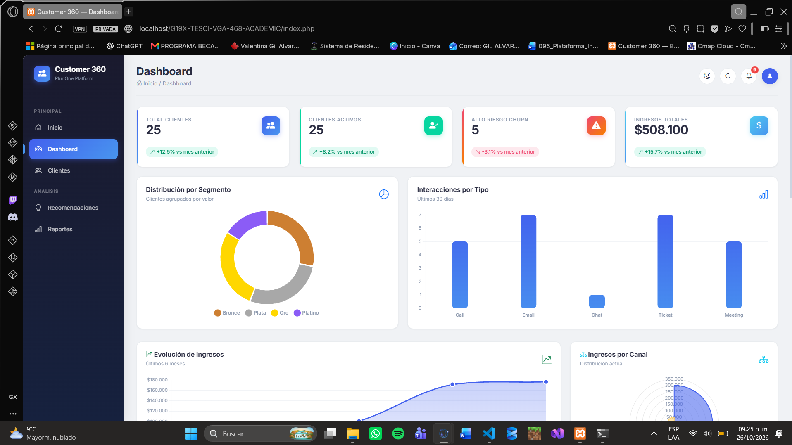
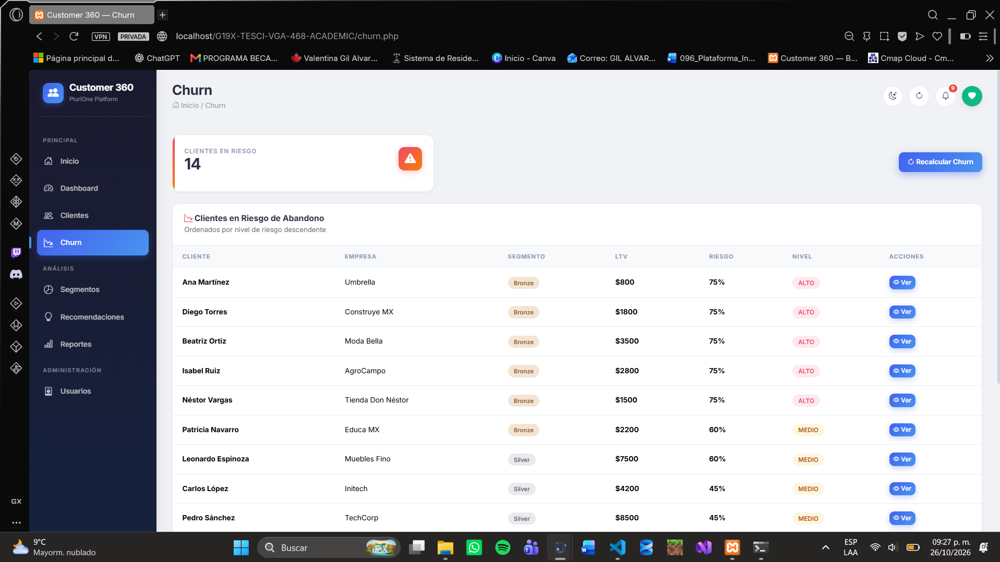
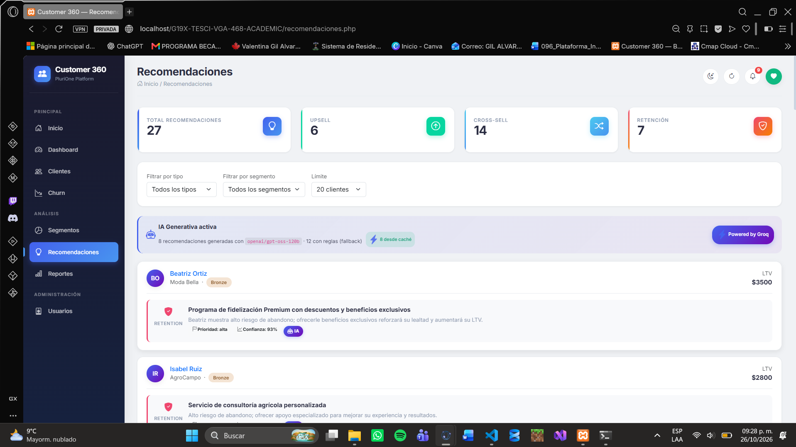
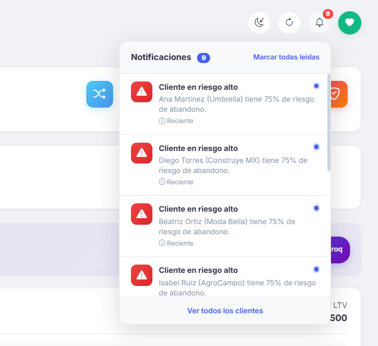
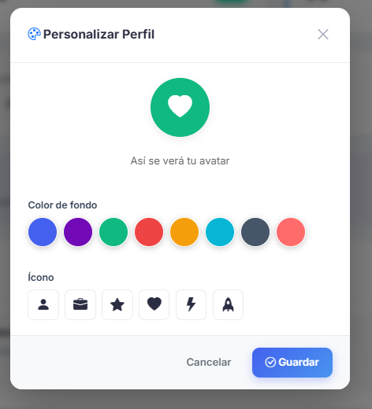

# Instalación desde cero — 27-oct-2026 · commit 6d3b78a

**Repositorio:** G19X-TESCI-VGA-468-ACADEMIC
**Entorno:** Windows 11, XAMPP (PHP 8.2, MariaDB 10.4), Chrome (Modo Incógnito)
**URL de prueba:** `http://localhost/G19X-TESCI-VGA-468-ACADEMIC/`

## Bitácora de pruebas

| Paso | Qué hice | Resultado |
|---|---|---|
| 1 | Ejecuté `git clone` en una carpeta nueva de `htdocs`. | ✅ Se creó la carpeta correctamente. |
| 2 | Creé la base de datos `customer360` en phpMyAdmin e importé `database/customer360.sql`. | ✅ Se crearon las 5 tablas (`users`, `customers`, `interactions`, `transactions`, `ai_cache`). |
| 3 | Copié `.env.example` a `.env` y configuré las credenciales. | ⚠️ Error de conexión: el `.env.example` trae el puerto `3306`, pero mi XAMPP usa el `3308`. Lo corregí en `.env` y conectó perfecto. |
| 4 | Abrí la URL en una ventana de incógnito. | ⚠️ Me mandaba directo al dashboard (por la cookie de sesión de mi proyecto original). En incógnito me pidió login correctamente. |
| 5 | Entré con los 4 roles (Admin, Analyst, Sales, Viewer). | ✅ Viewer no ve "Usuarios", ni "Churn" ni "Segmentos". |
| 6 | Revisé el Dashboard y busqué/filtré clientes en el listado. | ✅ Las gráficas cargan bien (después de mover Chart.js al `<head>`). El buscador de clientes filtra por nombre y empresa correctamente. |
| 7 | Recalculé el Churn y los Segmentos. | ✅ Los valores del SQL (LTV, segmento y churn) coinciden exactamente y **no cambiaron** al recalcular (los datos fueron corregidos en la BD para que cuadren). |
| 8 | Entré a la sección de Usuarios como Admin y creé un usuario de prueba. | ✅ El administrador puede gestionar usuarios (crear, editar y eliminar) sin problemas. |
| 9 | Abrí los perfiles 360° de los 25 clientes. | ✅ Todos tienen transacciones y un timeline de interacciones. |
| 10 | Probé las recomendaciones (con GROQ_API_KEY). | ✅ El banner dice "IA Generativa activa". Genera recomendaciones personalizadas. |
| 11 | Probé las recomendaciones (sin GROQ_API_KEY, usando `?rules=1`). | ✅ El banner cambia a "Modo reglas de negocio" y no se rompe. |
| 12 | Exporté reportes a CSV y a PDF (horizontal y vertical). | ✅ Descarga los archivos correctamente. |
| 13 | Revisé las notificaciones de la campana. | ✅ Aparecen las notificaciones (riesgo alto, tickets negativos) y los enlaces llevan al perfil correcto. |
| 14 | Cambié el avatar en "Personalizar perfil" y probé inyectar código malicioso. | ✅ Guarda el color e ícono. El servidor bloquea ataques con `{"error": "Ícono inválido"}`. |

## Notas y correcciones durante la prueba

- **Configuración del puerto de MySQL:** Se documentó en `.env.example` que el puerto puede variar en XAMPP (3306, 3307 o 3308).
- **Carga de scripts:** Chart.js se movió al `<head>` en `header.php` para asegurar que los gráficos rendericen antes de que `dashboard.js` los llame.
- **Datos de prueba:** Se ajustaron manualmente los valores de `churn_risk` y `segment` en el SQL para que coincidan al 100% con la lógica de `api/churn.php` y `api/segments.php`.

## 📸 Capturas de pantalla de la instalación
*(Las capturas se encuentran en `docs/screenshots/`)*

### 1. Dashboard con datos reales

### 2. Permisos por rol (Viewer)

### 3. Recalcular Churn

### 4. Recomendaciones con IA

### 5. Notificaciones dinámicas

### 6. Personalización de avatar
